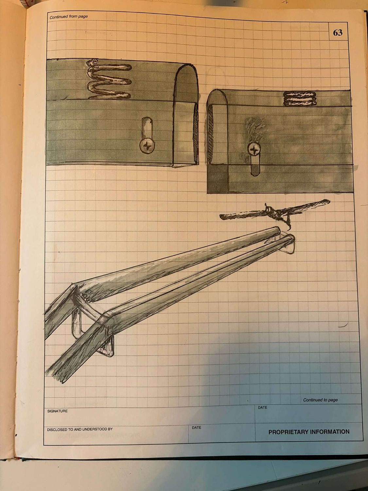

# Charter Project: Drone Rail Recovery System

A portable, modular rail system for landing and recovering a fixed-wing drone. The drone lands with its body between two straight, parallel rails and its wing roots resting on sprung carbon fibre caps. It then slides to a smooth, slow stop. The sections are carried by vehicle or by one or two people, and the system is meant to work on the ground, on vehicles and on ship decks.

It is a mock concept and prototype, modelled in Autodesk Fusion. Every size is a Fusion User Parameter, in metric.

## Design basis

| Item | Value |
|---|---|
| Drone mass | 140.6 kg (310 lb) |
| Wingspan | 6.1 m (20 ft) |
| Body width | 432–508 mm |
| Landing speed | 40 knots nominal, 45 knots design max |
| Where the rails touch the drone | Wing root, where the wing blends into the body |
| Propeller | One at the nose (puller). It must be stopped blades-vertical or folded at touchdown |
| Tail | The underside of the horizontal tail must sit at least 330 mm above the wing underside, or the drone uses a V-tail or T-tail |

The full design spec is [drone-rail/spec.md](drone-rail/spec.md), and the build log is [drone-rail/progress.md](drone-rail/progress.md).

## Versions

Every version is its own folder, grouped by what it changes. Each version folder holds:

- `build_<ID>.py`: the Fusion Python script that builds that version. It uses the shared code in `drone-rail/fusion-scripts/`.
- `*.png`: pictures of the model.
- `*.f3d` or `*.f3z`: the Fusion model itself. A design with linked parts (the multi-section runs) is exported as .f3z.

| Group | Versions |
|---|---|
| `00-base-section` | The shared rail section every version is built from |
| `01-entry` | **G1** funnel · **G2** V-shaped caps · **G3** roller guides |
| `02-stopping` | **A** friction only · **B** braking zone · **C** uphill end ramp · **D1** catch net · **D2** grip that rises along the run · **D3** arresting cable |
| `03-damping` | **S1** springs only · **S2** spring plus shock absorber · **S3** rubber blocks |
| `04-mounting` | **M1** levelling feet · **M2** ground anchors · **M3** weighted feet · **M4** truck-bed or trailer adapter · **M5** ship-deck lashing · **M6** self-levelling mount |
| `05-scale-model` | 1:10 3D-printable model (STL) |

## Opening the models

In Fusion, use **File → Open → Open from my computer**, or upload the file to a Fusion project. To rebuild a version from its script instead, run its `build_<ID>.py` in Fusion (Utilities → Scripts and Add-Ins). The run stub is in `progress.md`.

## Status

The versions are built one group at a time, and this repo is updated as each group lands. See [drone-rail/progress.md](drone-rail/progress.md) for current state.
